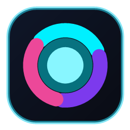

<div align="center">
  
  <h1>RGB Control Center</h1>
  <p>
    <strong>Central unificada de iluminação RGB/ARGB para Windows</strong><br/>
    Controle, sincronize e personalize periféricos e componentes de múltiplos fabricantes em uma única interface moderna, com comunicação real via USB/HID, SMBus e OpenRGB SDK.
  </p>
</div>

---

## 1. Funcionalidades Principais

- **Dashboard do Ecossistema RGB:** visão geral em tempo real dos dispositivos conectados, fabricante, modelo, status de compatibilidade, cor/efeito aplicado e atalhos rápidos.
- **Gerenciador de Dispositivos & Matriz de Diagnóstico:** identificação automática via USB/HID, SMBus/BIOS e TCP, exibindo capacidades reais de cada hardware e detecção de processos conflitantes (`RGBFusion.exe`, `OemDrv.exe`, Central Husky).
- **Editor Visual de Iluminação & Motor de Efeitos Dual-Color:**
  - Efeitos nativos em firmware: **Cor Estática**, **Rainbow**, **Breathing**, **Wave (Streaming)**, **Color Cycle (Neon)**, **Reactive**, **Strobing** e **Desligado**.
  - Efeitos em software (`SoftwareEffectRunner`) com controle de frequência seguro: **Gradiente (2 Cores)** e **Alternância (2 Cores)** entre a **Cor Primária** e a **Cor Secundária**.
  - Seletores RGB/HEX, sliders de brilho, velocidade, direção e salvamento direto na memória/EEPROM do dispositivo.
- **Sync RGB Global:** sincroniza cor, efeito, brilho e velocidade entre múltiplos fabricantes simultaneamente, com suporte a **exceções individuais** por dispositivo.
- **Perfis Personalizados (SQLite):** perfis integrados (*Gaming*, *Work*, *Night*, *Static*) e criação/edição/duplicação/exclusão de perfis do usuário com restauração automática na inicialização.
- **Execução em Segundo Plano (System Tray):** ao fechar a janela, o aplicativo é recolhido para a bandeja do Windows, mantendo os efeitos em software e a troca de perfis ativos com menu rápido por perfil.
- **Atalhos Globais para Troca de Perfil LED:**
  - `Ctrl + Alt + P` *(configurável em Configurações para `Ctrl+Shift+P`, `Ctrl+Alt+L`, `F9` ou `F10`)*: alterna ciclicamente entre todos os perfis salvos, mesmo em jogos ou minimizado na bandeja.
  - `Ctrl + Alt + 1` .. `Ctrl + Alt + 5`: aplica diretamente os 5 primeiros perfis e exibe notificação discreta na bandeja.
- **Cliente de Instalação Windows:** instalador gráfico nativo (`RGB-Control-Center-Setup-1.0.0.exe`) com criação de atalhos com ícone na Área de Trabalho/Menu Iniciar, opção de inicialização minimizada com o Windows e registro de desinstalação.
- **Segurança de Hardware (`HardwareSafetyValidator`):** fila assíncrona serializada por dispositivo (sem conflitos de barramento), validação estrita de tamanho de pacote (`64B`/`17B`), endereços EEPROM permitidos e checksums (`16-bit LE` e complemento `0x55`).

---

## 2. Hardware Diagnosticado e Suportado

| Componente | Fabricante | Modelo Identificado | VID / PID / Endereço | Protocolo de Controle | Status de Integração |
|---|---|---|---|---|---|
| **Placa-mãe** | Gigabyte | `B450M GAMING` (BIOS `F62`) | SMBus MCU `0x08210001` (`ITE 048D:8297`) | Ponte 32-bit `LedLib2.dll` / `SMBCtrl.dll` (`GVCIDrv64.sys`) + Conector RGB 12V (`PH_1`) | **Compatível** (Requer privilégio de Administrador para escrita SMBus) |
| **Teclado** | Husky Gaming (EVision/Sonix OEM) | `TG200` (Hailstorm 65% RGB / `TK50S`) | `VID_320F` & `PID_5016` (`MI_01&Col04`) | USB HID Custom Report 64 Bytes (`UsagePage 0xFF1C`, `Usage 0x0092`, `ReportID 0x04`) | **Compatível (Nativo)** |
| **Mouse** | Redragon (Compx OEM) | `M719RGB-PRO` Invader (`PMW3325`) | `VID_25A7` & `PID_FAB0` / `PID_FA7E` (`MI_01&Col07`) | USB HID Feature Report 17 Bytes (`UsagePage 0xFF02`, `Usage 0x0002`, `ReportID 0x08`) | **Compatível (Nativo)** |
| **Ponte Externa** | OpenRGB Project | `OpenRGB SDK Server v4` | `TCP 127.0.0.1:6742` | Protocolo binário `ORGB` v4 | **Integrado** (Para expansão futura de RAM/Coolers) |
| **Headset** | Logitech | `G325 Lightspeed` | `VID_046D` & `PID_0B21` | USB Audio / HID Consumer | **Sem Suporte RGB** (Informado com transparência na UI) |

> Para detalhes técnicos completos dos pacotes HID, endereços EEPROM e compatibilidade com o OpenRGB, consulte [`docs/COMPATIBILITY_MATRIX.md`](docs/COMPATIBILITY_MATRIX.md).

---

## 3. Stack Tecnológica

- **Desktop Runtime:** Electron 34 (`src/main`)
- **Interface Gráfica:** React 18 + Tailwind CSS (`src/renderer`)
- **Tipagem:** TypeScript (`src/shared`)
- **Gerenciamento de Estado:** Zustand (`src/renderer/store/useRgbStore.ts`)
- **Persistência Local:** SQLite nativo (`node:sqlite` com fallback transacional em `src/database/DatabaseManager.ts`)
- **Comunicação Nativa:** IPC seguro (`contextBridge`), Win32 HID (`hid.dll` / `kernel32.dll`), Ponte SMBus 32-bit (`LedLib2.dll`) e Cliente TCP OpenRGB SDK (`127.0.0.1:6742`).

---

## 4. Organização Modular do Projeto

```text
resources/       # Ícones oficiais da aplicação (icon.ico, icon.png, tray-icon.png)
scripts/         # Gerador de ícones e compilador do Cliente de Instalação Windows
src/
├── main/        # Processo principal do Electron, atalhos globais, IPC handlers e preload seguro
├── renderer/    # Interface React Dark Mode (Dashboard, Dispositivos, Editor, Sync RGB, Perfis, Matriz, Logs)
├── shared/      # Tipos, contratos, canais IPC e interface padrão IDeviceProvider
├── core/        # DeviceManager central, ConflictDetector e HardwareSafetyValidator
├── providers/   # Adaptadores modulares (GigabyteProvider, HuskyProvider, RedragonProvider, OpenRGBProvider, UnsupportedHidProvider)
├── profiles/    # ProfileManager (Gaming, Work, Night, Static, Custom + CRUD)
├── effects/     # EffectEngine e SoftwareEffectRunner (efeitos nativos e dual-color em software)
├── database/    # DatabaseManager (Persistência SQLite local)
├── services/    # AutoStartService, TrayService, LoggerService, StateRestoreService
├── utils/       # Conversores RGB/HEX e calculadoras de checksum (16-bit LE e complemento 0x55)
└── tests/       # Suite automatizada de testes de protocolo, segurança, mutex e persistência
```

---

## 5. Como Executar e Gerar o Instalador

### Instalar dependências
```bash
pnpm install
```

### Executar a bateria de testes
```bash
npm run build
npm test
```

### Iniciar o aplicativo Desktop
```bash
npm start
```
> **Dica:** Para habilitar também o controle SMBus do conector RGB 12V da placa-mãe Gigabyte, execute o terminal ou o aplicativo instalado como **Administrador**.

### Gerar pacote portátil e Cliente de Instalação Windows (`RGB-Control-Center-Setup-1.0.0.exe`)
```bash
npm run dist:installer
```
Os artefatos serão gerados em `release/`:
- `release/RGB-Control-Center-Setup-1.0.0.exe` — Cliente de instalação gráfico para Windows
- `release/RGB-Control-Center-win32-x64/` — Pacote portátil pronto para execução

---

## 6. Documentação Adicional

- [Arquitetura do Sistema (`docs/ARCHITECTURE.md`)](docs/ARCHITECTURE.md)
- [Matriz de Compatibilidade e Diagnóstico de Hardware (`docs/COMPATIBILITY_MATRIX.md`)](docs/COMPATIBILITY_MATRIX.md)
- [Guia para Adicionar Novos Fabricantes (`docs/PROVIDER_GUIDE.md`)](docs/PROVIDER_GUIDE.md)
