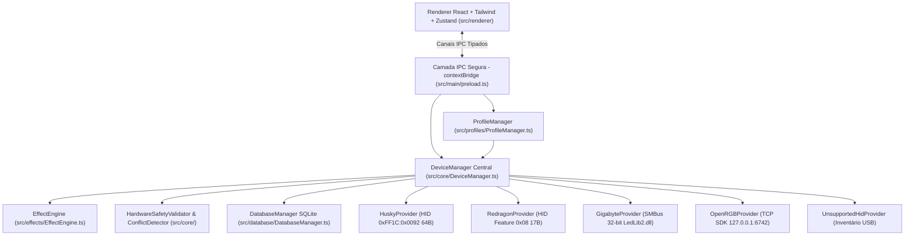

# Arquitetura do Sistema — RGB Control Center

## 1. Visão Geral Arquitetural

O **RGB Control Center** segue uma arquitetura modular em camadas com separação estrita entre a interface gráfica (`src/renderer`), o gerenciamento central de domínio (`src/core`, `src/effects`, `src/profiles`, `src/database`, `src/services`) e os adaptadores de hardware específicos de cada fabricante (`src/providers`).

---

## 2. Camada de Abstração de Providers (`IDeviceProvider`)

Todos os fabricantes implementam o contrato padronizado definido em [`src/shared/types.ts`](../src/shared/types.ts):

- `discoverDevices()`
- `getDeviceInfo(deviceId)`
- `getCapabilities(deviceId)`
- `getLightingState(deviceId)`
- `setColor(deviceId, color, secondaryColor)`
- `setEffect(deviceId, effect, options)`
- `setBrightness(deviceId, brightness)`
- `setSpeed(deviceId, speed)`
- `saveProfile(deviceId)`
- `disconnect()`

---

## 3. Segurança e Estabilidade de Hardware

1. **Validação de Pacotes (`HardwareSafetyValidator`):**
   - Verifica tamanho exato de cada relatório HID (`64` bytes para Husky, `17` bytes para Redragon).
   - Recalcula e confere o checksum antes do envio (`16-bit Little-Endian` para Husky, complemento `0x55` para Redragon).
   - Restringe escritas EEPROM no mouse Redragon exclusivamente aos endereços de iluminação documentados (`0x004C`, `0x0054`, `0x0058`, `0x00A0`), bloqueando qualquer tentativa de escrita fora da tabela RGB.
2. **Prevenção de Conflitos (`ConflictDetector`):**
   - Inspeciona processos ativos em busca de `RGBFusion.exe`, `SelLedV2.exe`, `OemDrv.exe`, `Central de Controle Husky.exe` e `SignalRgb.exe`.
   - Caso um software oficial esteja aberto para o mesmo fabricante, bloqueia a escrita concorrente e alerta o usuário na interface.
3. **Mutex por Dispositivo:**
   - Garante serialização das requisições de hardware com intervalo seguro entre pacotes HID/SMBus.
4. **Elevação Administrativa Sob Demanda:**
   - O aplicativo inicia como usuário padrão (`asInvoker`) para controlar periféricos USB HID sem solicitar UAC desnecessariamente, e oferece elevação UAC explícita apenas quando o usuário deseja controlar o barramento SMBus da placa-mãe Gigabyte (`GVCIDrv64.sys`).
